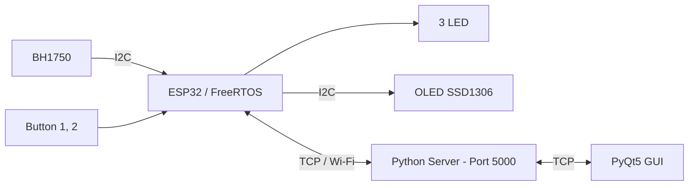
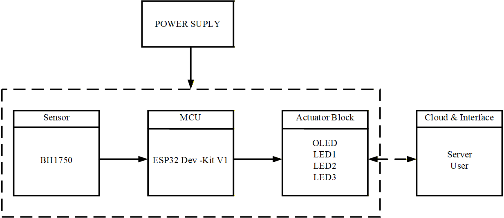

# 🚀 FreeRTOS Multi-Task System on ESP32

> **Môn học:** Hệ điều hành thời gian thực — RTOS345264_02  
> **Trường:** Đại học Công nghệ Kỹ thuật TP. HCM — Khoa Điện – Điện tử  
> **Học kỳ:** HK2 — Đợt 1 — Năm học 2025–2026  
> **Giảng viên hướng dẫn:** ThS. Huỳnh Hoàng Hà

---

## 📋 Giới thiệu dự án

Đây là dự án học tập và phát triển của nhóm trong môn Hệ điều hành thời gian thực. Nhóm xây dựng hệ thống trên ESP32 để thực hành lập lịch tác vụ, xử lý nút nhấn, đồng bộ bằng binary semaphore và giao tiếp giữa thiết bị nhúng với máy tính.

Hệ thống đọc cường độ ánh sáng từ **BH1750**, điều khiển **3 LED**, hiển thị trên **OLED SSD1306** và kết nối với ứng dụng **PyQt5** qua **TCP**. Dự án gồm hai phiên bản:

| Phiên bản | Cách tổ chức |
| --- | --- |
| **OS — FreeRTOS** | Chia ứng dụng thành các task, dùng ngắt và semaphore; tích hợp Wi-Fi/TCP |
| **Non-OS — Super Loop** | Xử lý LED, nút nhấn, cảm biến và OLED trong loop(), quản lý thời gian bằng millis() |

## 🔧 Phần cứng và công cụ

- ESP32 DevKit V1; cảm biến ánh sáng BH1750.
- OLED SSD1306 128×64, giao tiếp I2C.
- 3 LED, điện trở hạn dòng, 2 nút nhấn, testboard và dây kết nối.
- PlatformIO / Arduino framework, FreeRTOS, Python, PyQt5 và Qt Designer.

## 🗂️ Cấu trúc thư mục

```text
firmware/
├── rtos/
│   ├── src/main.cpp             # FreeRTOS, LED, cảm biến, OLED và TCP
│   ├── include/config.example.h # Mẫu cấu hình Wi-Fi và server
│   └── platformio.ini
└── non-os/
    ├── src/main.cpp             # Super Loop dùng millis()
    └── platformio.ini
desktop/
├── server.py                    # Server chuyển tiếp dữ liệu TCP
├── client/                      # Ứng dụng PyQt5, UI và resource ảnh
├── qt/                          # File Qt Designer và tài nguyên
└── requirements.txt
docs/images/                     # Sơ đồ và hình giao diện
```

## ⚡ Các tác vụ trong hệ thống

### Phiên bản FreeRTOS

Ứng dụng tạo **6 task**. BTN2 sử dụng ngắt ngoài để cấp binary semaphore cho task điều khiển LED.

| Task | Chức năng | Chi tiết |
| --- | --- | --- |
| Blink | Nhấp nháy LED | Bật 100ms, tắt 100ms; chu kỳ đặt là 200ms |
| BH1750 | Đọc cảm biến | Kiểm tra dữ liệu mỗi 500ms, lưu giá trị lux |
| Toggle | BTN1 điều khiển LED2 | Đảo trạng thái khi nhấn rồi thả nút |
| Sema | LED theo sự kiện | Chờ semaphore từ ISR của BTN2, bật khoảng 3 giây rồi tắt |
| OLED | Hiển thị | Lux, trạng thái LED2, bộ đếm và phản hồi server |
| TCP | Giao tiếp máy tính | Gửi JSON trạng thái và nhận lệnh điều khiển |

| Cơ chế FreeRTOS | Ứng dụng |
| --- | --- |
| xTaskCreate() | Tạo task, thiết lập độ ưu tiên |
| vTaskDelay() | Chờ và nhường CPU cho task khác |
| xSemaphoreCreateBinary() | Tạo binary semaphore |
| xSemaphoreGiveFromISR() | Báo sự kiện từ ngắt BTN2 |
| xSemaphoreTake() | Chờ sự kiện trước khi điều khiển LED |

### Phiên bản Non-OS

Các chức năng được xử lý trong `loop()`: LED1 nhấp nháy chu kỳ 200ms, đọc BH1750 mỗi 500ms, BTN1 đảo LED2, BTN2 kích hoạt LED3 trong 3 giây và cập nhật OLED mỗi 500ms. Biến trạng thái và các mốc `millis()` quản lý thời gian cho từng công việc.

“Non-OS” chỉ cách tổ chức ứng dụng bằng Super Loop; Arduino framework trên ESP32 vẫn sử dụng FreeRTOS bên dưới.

📊 Lưu đồ: [Chương trình OS](docs/images/rtos-flow.png) · [Chương trình Non-OS](docs/images/non-os-flow.png)

## 🌐 Giao tiếp ESP32 — Server — GUI



ESP32 gửi dữ liệu cảm biến và trạng thái LED tới server Python. Server chuyển dữ liệu đến GUI và chuyển lệnh từ GUI về ESP32.

```json
{"lux": 125.50, "led_tg": 1, "led_sema": 0}
```

Các lệnh firmware đang xử lý: `LED1_ON` kích hoạt LED semaphore khoảng 3 giây; `LED2_ON` và `LED2_OFF` điều khiển LED toggle. Trong GUI, nhãn **LED 1** tương ứng LED semaphore; LED nhấp nháy hoạt động theo task riêng.

## 🖥️ Giao diện PyQt5


*Giao diện ở trạng thái ban đầu, chưa kết nối thiết bị.*

Ứng dụng có các nút gửi lệnh LED, vùng hiển thị trạng thái và giá trị ánh sáng, đồng hồ ngày giờ, cùng ô gửi dữ liệu văn bản. Giao diện được thiết kế bằng Qt Designer; luồng nhận TCP sử dụng `QThread` để xử lý dữ liệu gửi về.

## 📌 Kết nối phần cứng

| Thành phần | FreeRTOS | Non-OS |
| --- | --- | --- |
| LED nhấp nháy | GPIO 27 | GPIO 15 |
| LED toggle | GPIO 26 | GPIO 4 |
| LED semaphore / hẹn giờ | GPIO 25 | GPIO 23 |
| BTN1 | GPIO 32 | GPIO 5 |
| BTN2 | GPIO 33 | GPIO 18 |
| SDA / SCL | GPIO 21 / 22 | GPIO 21 / 22 |
| BH1750 | I2C, 0x23 | I2C |
| OLED SSD1306 | I2C, 0x3C | I2C, 0x3C |

Nối dây theo đúng phiên bản firmware. Nút nhấn dùng `INPUT_PULLUP`, nối xuống GND khi nhấn; LED cần điện trở hạn dòng.



## 🚀 Cài đặt và chạy

### 1. Firmware ESP32

Cài PlatformIO, mở `firmware/rtos/`. Các thư viện **Adafruit GFX**, **Adafruit SSD1306**, **BH1750** đã khai báo trong `platformio.ini`; board sử dụng là `esp32doit-devkit-v1`.

Sao chép `include/config.example.h` thành `include/config.local.h`, điền Wi-Fi và IP LAN của máy chạy server. File cấu hình riêng được bỏ qua bởi Git.

Chạy tại thư mục `firmware/rtos/`:

```powershell
pio run
pio run --target upload
pio device monitor --baud 115200
```

Với Non-OS, mở `firmware/non-os/` và dùng các lệnh tương tự; không cần cấu hình mạng.

### 2. Server TCP

Tại thư mục gốc repository:

```powershell
python -m venv .venv
.\.venv\Scripts\python.exe -m pip install -r desktop/requirements.txt
.\.venv\Scripts\python.exe desktop/server.py
```

### 3. Ứng dụng PyQt5

Mở terminal thứ hai tại thư mục gốc:

```powershell
$env:RTOS_SERVER_IP = '127.0.0.1'
.\.venv\Scripts\python.exe desktop/client/client.py
```

Nếu GUI và server chạy khác máy, thay `127.0.0.1` bằng IP máy server. ESP32 và máy tính cần kết nối được với nhau qua mạng LAN, sử dụng cổng TCP **5000**.

## 🧠 Kiến thức thực hành và hướng phát triển

Dự án giúp nhóm thực hành cách chia tác vụ, thiết lập độ ưu tiên, xử lý ngắt, đồng bộ bằng semaphore và kết nối hệ thống nhúng với giao diện máy tính.

Các hướng tiếp tục hoàn thiện:

- Đồng bộ truy cập I2C và dữ liệu dùng chung giữa các task.
- Bổ sung chống dội nút nhấn, timeout và tự kết nối lại khi mất mạng.
- Hoàn thiện xử lý dòng dữ liệu TCP và cập nhật trạng thái GUI.
- Bổ sung xử lý lệnh `LED1_OFF` và cập nhật bộ đếm OLED độc lập.
- Đo thời gian đáp ứng của các tác vụ trong quá trình vận hành.

## 👥 Thành viên nhóm

| STT | Họ và tên |
| --- | --- |
| 1 | Phạm Ngọc Duy |
| 2 | [Hà Quang Huy](https://github.com/haquanghuy1230-wq) |
| 3 | Lê Đoàn Thái Khương |
| 4 | Võ Trung Nguyên |

---

📚 Dự án phục vụ học tập và phát triển kỹ năng lập trình hệ thống nhúng trong môn Hệ điều hành thời gian thực.
