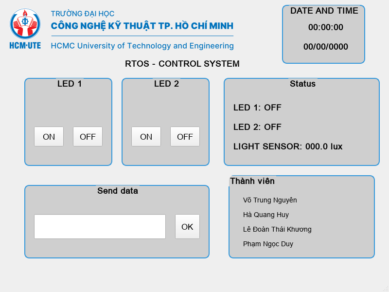
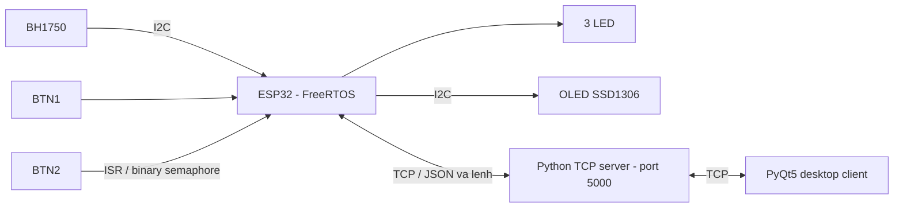

# ESP32 FreeRTOS Control System

**Hệ thống đa tác vụ trên ESP32: đọc cảm biến ánh sáng BH1750, điều khiển LED, đồng bộ bằng semaphore và giám sát qua giao diện PyQt5/TCP.**

`ESP32` · `FreeRTOS` · `C++ / Arduino` · `PlatformIO` · `BH1750` · `SSD1306` · `Python / PyQt5` · `TCP`



*Giao diện dựng trực tiếp từ mã UI đã khôi phục; ảnh chưa kết nối ESP32, các giá trị là trạng thái ban đầu.*

## Thông tin dự án

Đồ án môn **Hệ điều hành thời gian thực**, mã môn `RTOS345264_02`, học kỳ 2 – đợt 1, năm học 2025–2026. Theo báo cáo `RTOS_report.docx`: Trường Đại học Công nghệ Kỹ thuật TP. HCM, Khoa Điện – Điện tử; giảng viên hướng dẫn **ThS. Huỳnh Hoàng Hà**; bìa báo cáo ghi tháng 3/2026.

| Thành viên nhóm theo báo cáo |
| --- |
| Phạm Ngọc Duy |
| **Hà Quang Huy** — [GitHub](https://github.com/haquanghuy1230-wq) |
| Lê Đoàn Thái Khương |
| Võ Trung Nguyên |

Repository lưu lại mã còn tìm thấy trong thư mục dự án và mã Non-OS khôi phục từ báo cáo. Tài liệu hiện có chưa xác định phần việc cá nhân, nên các chức năng được ghi nhận là kết quả dự án nhóm.

## Mục tiêu

So sánh cách tổ chức ứng dụng theo vòng lặp `millis()` với cách chia tác vụ bằng FreeRTOS; thực hành sự kiện từ nút nhấn, binary semaphore, đọc cảm biến, hiển thị OLED và giao tiếp TCP với máy tính.

| Chức năng | Bản FreeRTOS của nhóm |
| --- | --- |
| LED nhấp nháy | Task riêng, HIGH/LOW mỗi 100ms; chu kỳ danh định 200ms |
| Đọc BH1750 | Kiểm tra cảm biến mỗi 500ms, lưu giá trị lux |
| Nút nhấn LED2 | BTN1 đảo trạng thái LED toggle |
| LED theo sự kiện | ISR của BTN2 cấp semaphore; task nhận và bật LED khoảng 3s |
| OLED 128×64 | Hiển thị lux, LED toggle, bộ đếm và phản hồi server |
| TCP | ESP32 gửi JSON trạng thái, nhận lệnh qua server Python |
| PyQt5 | Hiển thị lux/trạng thái, nút gửi lệnh, gửi chuỗi và đồng hồ |

Các khoảng thời gian trên là giá trị đặt trong mã, chưa có phép đo timing/jitter được xác nhận.

## Kiến trúc bản của nhóm



Mã FreeRTOS hiện có tạo **6 task**: Blink, BH1750, Toggle, Sema, OLED và TCP. Sự kiện BTN2 được xử lý bằng ISR; gửi/nhận TCP gộp trong một task. Không có queue hoặc Firebase trong bản của nhóm tìm thấy trên máy.

## Các phiên bản và nguồn mã

| Thư mục | Nguồn | Nội dung |
| --- | --- | --- |
| `firmware/rtos/` | Mã còn lưu trong `OS_Project` của nhóm | ESP32 DevKit V1, BH1750, FreeRTOS, TCP |
| `firmware/non-os/` | Mục 4.2.2 của báo cáo nhóm | Super loop dùng millis(), BH1750, LED và OLED |
| `desktop/` | Server/client/Qt Designer còn lưu của nhóm | Python TCP relay và PyQt5 |
| `reference/upstream/` | [TuanNguyn-11/RTOS-FreeRTOS-ESP32](https://github.com/TuanNguyn-11/RTOS-FreeRTOS-ESP32) | Bản tham khảo ESP32-S3, MPU6050 và Firestore của nhóm khác |

**Bản tham khảo dùng phần cứng và giao tiếp khác bản báo cáo của nhóm.** Mã tham khảo được tải theo yêu cầu, ghi nhận nguồn riêng; không được trình bày là mã do nhóm Hà Quang Huy viết. Xem [nguồn và thay đổi khi khôi phục](docs/PROVENANCE.md).

## OS và Non-OS

| Tiêu chí | FreeRTOS của nhóm | Non-OS từ báo cáo |
| --- | --- | --- |
| Tổ chức ứng dụng | Task và ISR | Các khối xử lý trong loop() |
| Sự kiện BTN2 | Binary semaphore | Biến led3Running |
| Thời gian | vTaskDelay / semaphore wait | Kiểm tra millis() |
| Cảm biến | BH1750 | BH1750 |
| Mạng | Wi-Fi và TCP | Không có mã mạng trong đoạn khôi phục |
| GPIO | Theo main.cpp bản RTOS | Theo đoạn code báo cáo; khác bản RTOS |

“Non-OS” là tên gọi của kiến trúc ứng dụng trong bài học. Khi chạy với Arduino core cho ESP32, framework bên dưới vẫn dùng FreeRTOS; không nên hiểu đây là bản firmware bare-metal hoàn toàn.

## Cấu trúc

```text
firmware/
  rtos/                    # PlatformIO, firmware gốc của nhóm đã tách cấu hình
  non-os/                  # C++ khôi phục từ báo cáo, cấu hình PlatformIO bổ sung
desktop/
  server.py                # TCP relay
  client/                  # Logic PyQt5, UI Python và resource ảnh
  qt/                      # Qt Designer .ui/.qrc và ảnh gốc
  requirements.txt
reference/upstream/        # Snapshot mã tham khảo, đã bỏ credential thật
docs/
  images/                  # Sơ đồ của nhóm và ảnh UI dựng từ source
  SETUP.md                 # Cách chạy
  HARDWARE.md              # GPIO riêng cho từng phiên bản
  KNOWN_LIMITATIONS.md     # Các hạn chế quan sát từ mã
  REPORT_SUMMARY.md        # Tóm tắt báo cáo
  PROVENANCE.md            # Nguồn, commit tham khảo và thay đổi
```

## Chạy dự án

1. Nối chân theo [HARDWARE.md](docs/HARDWARE.md), chọn đúng phiên bản.
2. Với bản RTOS: sao chép `firmware/rtos/include/config.example.h` thành `config.local.h`, điền Wi-Fi và IP máy chạy server.
3. Build/upload bằng PlatformIO tại `firmware/rtos/` hoặc `firmware/non-os/`.
4. Cài Python dependency, chạy `desktop/server.py`, sau đó chạy `desktop/client/client.py`.

Lệnh và cấu hình chi tiết tại [SETUP.md](docs/SETUP.md). Máy tính và ESP32 cần truy cập được nhau qua mạng LAN.

## Trạng thái và hướng phát triển

Đã khôi phục source, tách thông tin mạng riêng và kiểm tra cú pháp Python; giao diện Qt được dựng để kiểm tra UI. Chưa xác nhận build firmware, chạy phần cứng hoặc đo hiệu năng. Báo cáo còn để trống Chương 5–6 nên repository không bổ sung kết quả thực nghiệm suy đoán.

Các điểm cần hoàn thiện: xử lý framing TCP, đồng bộ tài nguyên I2C và dữ liệu dùng chung, timeout/reconnect, chống dội nút và thống nhất ánh xạ LED giữa UI/firmware. Chi tiết tại [KNOWN_LIMITATIONS.md](docs/KNOWN_LIMITATIONS.md).

Chưa chọn giấy phép phân phối lại cho dự án nhóm. Mã tham khảo và tài nguyên bên thứ ba giữ ghi nhận nguồn; repository gốc được tải không kèm file LICENSE cấp quyền sử dụng lại.
